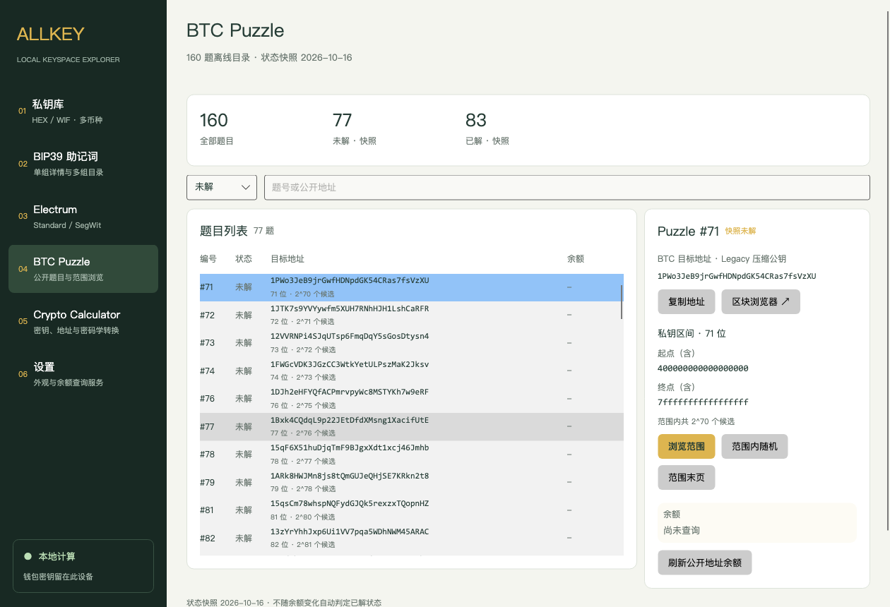

# AllKey

[English](README.md) | [简体中文](README.zh-CN.md)

AllKey 是支持 **macOS 和 Windows** 的桌面密码学与钱包派生工具。macOS 使用 SwiftUI，Windows 使用 Avalonia / .NET，两端共享仓库内的 Go 核心。密钥派生和计算在本机完成，无需 WebView 或远程计算服务。

## 下载与运行

在 [GitHub Releases](https://github.com/0x588/allkeyui/releases/latest) 下载 **v0.1.4**。

| 平台 | 下载 | 运行环境 |
| --- | --- | --- |
| macOS 通用版 | [AllKey-macOS-universal.zip](https://github.com/0x588/allkeyui/releases/latest/download/AllKey-macOS-universal.zip) | macOS 13+，Apple Silicon / Intel |
| Windows x64 | [AllKeyUI-win-x64.zip](https://github.com/0x588/allkeyui/releases/latest/download/AllKeyUI-win-x64.zip) | Intel / AMD 64 位 Windows |
| Windows ARM64 | [AllKeyUI-win-arm64.zip](https://github.com/0x588/allkeyui/releases/latest/download/AllKeyUI-win-arm64.zip) | 原生 ARM64 Windows |
| 校验文件 | [SHA256SUMS.txt](https://github.com/0x588/allkeyui/releases/latest/download/SHA256SUMS.txt) | 下载包 SHA-256 |

**macOS：**解压后将 `AllKeyUI.app` 移至“应用程序”。当前版本未经 Developer ID 签名及公证；首次尝试打开后，可能需要在“系统设置 → 隐私与安全性”中批准运行。

**Windows：**完整解压，进入对应架构目录运行 `AllKeyUI.exe`。保留同目录的 DLL、JSON 和运行文件；包内已包含 .NET 运行时，无需安装 Go 或 .NET。当前为未签名便携版，请按系统原生架构选包。

README 提供中英文版本，当前应用界面主要为中文。

## 主要功能

- **私钥库：**支持 BTC、ETH、BSC、LTC、DOGE、TRX、SOL；HEX / WIF 识别校验、批量派生、首尾 / 前后 / 安全随机导航、BTC 地址类型筛选。
- **BIP39：**12–24 词、Passphrase、账户与地址索引、标准或自定义派生路径、词表补全、已知公开地址本地匹配，以及使用 `?` 标记缺词的可取消查询。
- **多组助记词目录：**每页多组、独立导航、首个地址预览、余额筛选和单组详情。
- **Electrum：**Standard / SegWit 助记词、地址派生、索引导航与助记词定位。
- **BTC Puzzle：**160 题离线目录、筛选搜索、精确密钥区间与范围导航。进入页面后，通过已配置的 BTC 服务自动查询公开目标余额；已解状态始终为带日期的快照，不由余额自动推断。
- **密码学计算器：**46 项操作，涵盖密钥 / 地址 / WIF 转换、哈希、编解码和非 EC-multiply BIP38，支持逐行批量处理。
- **余额查询：**主备服务、渐进更新、受控并发、60 秒成功缓存、手动强制刷新，以及有余额 / 有交易 / 失败筛选；查询失败不作为零余额。
- **自定义 EVM 网络：**HTTPS RPC、链 ID 校验、主币单位、浏览器链接及网络独立缓存。



## 隐私与配置

私钥、助记词、Passphrase 和派生路径留在本机。余额查询只向你配置的服务商发送公开地址。生成地址的自动余额刷新默认关闭；BTC Puzzle 公开目录在进入页面后自动刷新。余额服务需先配置，部分服务需要 API Key。

服务地址与 API Key **以明文**保存在本机 `balance-settings.json` 中，并限制当前用户访问。可在设置中打开配置目录查看实际位置；Windows 默认位于 `%LOCALAPPDATA%\AllKeyUI`。敏感内容复制后 60 秒，仅在剪贴板仍包含该内容时清除。

公开源码不包含个人配置或构建输出。评估应用时请使用公开测试向量。

## 从源码构建

```bash
git clone https://github.com/0x588/allkeyui.git
cd allkeyui
```

### macOS

需要 macOS 13+、Xcode（项目使用 Xcode 27 验证）和 Go 1.24+。

用 Xcode 打开 `AllKeyUI.xcodeproj`，选择 `AllKeyUI` scheme 后运行。构建会编译 Apple Silicon 和 Intel 两种 Go 静态库。若 Go 不在常见安装路径，在 target 构建设置中将 `GO_BINARY` 设为其完整路径。

```bash
xcodebuild -project AllKeyUI.xcodeproj -scheme AllKeyUI \
  -configuration Release -derivedDataPath .build/ReleaseDerived \
  CODE_SIGNING_ALLOWED=NO ONLY_ACTIVE_ARCH=NO build
```

应用输出：`.build/ReleaseDerived/Build/Products/Release/AllKeyUI.app`。

### Windows

需要 .NET 10 SDK、Go 1.24+ 和与目标架构匹配的 C 编译器。Visual Studio 可打开 C# 工程；发布时还需编译 Go 原生 DLL。

Windows 上使用 MinGW-w64 / LLVM-MinGW：

```powershell
& .\scripts\build_windows_app.ps1
& .\scripts\build_windows_app.ps1 -Architecture arm64 -CCompiler 'C:\llvm-mingw\bin\aarch64-w64-mingw32-clang.exe'
```

在 macOS / Linux 上交叉构建：

```bash
bash scripts/build_windows_app.sh
WINDOWS_ARCH=arm64 WINDOWS_CC=/path/to/aarch64-w64-mingw32-clang \
  bash scripts/build_windows_app.sh
```

输出位于 `.build/windows-app/win-x64` 和 `win-arm64`。更多入口见 [Windows 构建与验证说明](Windows/README.md)。

## 验证与发布状态

```bash
(cd NativeCore && go test ./...)
xcodebuild -project AllKeyUI.xcodeproj -scheme AllKeyUI \
  -configuration Debug -derivedDataPath .build/DerivedData \
  CODE_SIGNING_ALLOWED=NO test
```

v0.1.4 Windows ARM64 完整包在 Windows 11 通过 34 项核心 / 服务检查、111 项 UI 检查；同一桌面 UI 在 macOS 开发宿主通过 111 项检查。x64 包已交叉构建，最近一次原生 Windows 10 回归为 v0.1.3，结果为 34 项核心 / 服务和 106 项 UI 检查通过。macOS 自动余额刷新通过 3 项针对性测试。服务协议测试使用固定响应，不访问个人钱包或真实服务账户。

当前为早期便携版，签名 / 公证、安装器、自动更新、完整界面本地化和更广泛的人工测试仍待完成。余额服务可用性与配额取决于你的配置。

## 源码结构

- `AllKeyUI/`、`AllKeyUITests/`：macOS 应用与 Swift 测试。
- `NativeCore/`：共享 Go 实现与测试。
- `Windows/`：Windows UI、服务与验证工具。
- `WindowsPoC/`：最初的原生桥接验证工程。
- `scripts/`：构建与验证脚本。
- `THIRD_PARTY_NOTICES/`：随发布包分发的第三方许可文本。

`docs/`、`.build/`、本机 IDE 状态和个人配置不进入公共仓库。二进制下载包作为 GitHub Release 附件提供。
